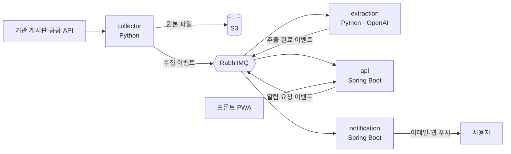

# 무주택자들 — 공공 주거·창업지원 공고 자격 판정 서비스 (백엔드)

지방 공사 게시판과 공공 API에서 주거·창업지원 공고를 자동으로 모으고, AI로 공고문에서 자격 조건을 뽑아 둡니다.
사용자가 나이·거주지·소득 같은 조건을 넣으면 공고마다 **「지원 가능 / 확인 필요 / 지원 불가」** 를 판정하고, 지원 가능한 공고부터 정렬한 맞춤 목록을 줍니다.
공고 위치의 생활권(교통·학교·공원·편의·병원) 점수와 통근 거리도 함께 보여 줍니다.

- **기간** 2026.10 ~ 2026.11 · 4인 팀 프로젝트 (백엔드)
- **원본 저장소** [prgrms-be-devcourse/NBE11-13-final-Team02](https://github.com/prgrms-be-devcourse/NBE11-13-final-Team02) — 이 저장소는 개인 보관용 fork입니다

## 기술 스택
| 분류 | 사용 |
| --- | --- |
| API·알림 서버 | Java 25, Spring Boot 4.1, Spring Data JPA, Flyway |
| 수집·AI 추출 | Python 3.12, uv, BeautifulSoup, OpenAI API |
| 데이터 | PostgreSQL + PostGIS, RabbitMQ, S3 (로컬은 MinIO) |
| 인프라·운영 | AWS EC2 / RDS / S3, Docker Compose, Nginx, GitHub Actions |
| 측정 | k6, Prometheus / Grafana, CloudWatch |

## 아키텍처


- 서비스 네 개는 **RabbitMQ 이벤트로만** 이어집니다. 모든 메시지는 같은 봉투(이벤트 ID·종류·스키마 버전·발생 시각)를 쓰고, 계약은 `contracts/`의 JSON Schema로 관리합니다.
- 보내는 쪽은 **아웃박스 패턴**으로 저장과 발행을 묶고, 받는 쪽은 이벤트 ID로 중복을 걸러 한 번만 처리합니다.
- 서비스마다 DB를 따로 씁니다 (collector · extraction · api · notification).
- api는 기능 모듈(notice · benefit · eligibility · area · user · notification · chat)로 나누고, 모듈 사이 호출 방향을 테스트(`ModuleStructureTest`)로 강제합니다.

## 내가 맡은 것
인프라·CI·배포, 서비스 네 개를 잇는 이벤트 플랫폼, 공고 수집기, 자격 판정 엔진과 맞춤 목록, 공고 주소를 좌표·생활권 점수로 바꾸는 파이프라인, 성능 측정과 개선 (팀 저장소에 머지된 PR 196개 중 101개).

> 각 작업의 설계 이유·원인 추적·전후 수치는 PR 본문에 적었고, [PR 보관본](docs/pr-archive/README.md)에 내 PR 101개와 팀원 PR 리뷰 11건을 옮겨 두었습니다.

### 자격 판정 엔진
- 판정 규칙을 **스프링·JPA 없는 순수 자바 패키지**로 분리해 단위 테스트와 정답 케이스 파일로 검증했습니다.
- 조건마다 충족 / 불충족 / **모름** 세 값으로 판정합니다. AI가 일부만 뽑은 공고나 엔진이 모르는 조건은 「지원 가능」으로 단정하지 않고 「직접 확인이 필요한 항목」으로 돌려줍니다. 틀린 「지원 가능」이 가장 해롭기 때문입니다.
- 소득·자산·생년월일은 **저장하지도, 로그에 남기지도 않습니다.** 문자열 변환·JSON 직렬화·오류 로그에서 값을 가리는 공통 장치를 두었습니다.

### 맞춤 목록 성능 — 공고 1만 개, 100명 동시 부하
| p95 | 개선 전 | N+1 제거·읽는 칸 줄이기 | 판정 모델 캐시 |
| --- | --- | --- | --- |
| 판정 | 1,202ms | 935ms | **154ms** |
| 목록·검색 | 611ms | 550ms | **129ms** |
| 조회 | 169ms | 121ms | **18ms** |

- 요청당 SQL 1,102개 → 8개 (N+1 제거, [#100](docs/pr-archive/prs/100.md)), 판정에 쓰는 칸만 읽어 DB 전송량 48MB → 15MB ([#199](docs/pr-archive/prs/199.md)).
- AI 추출 JSON(53.5KB)이 아니라 한 번 읽어 만든 **판정 모델(4.4KB)** 을 프로세스 안 캐시에 담습니다. 키를 (공고 ID, 버전)으로 잡아 **캐시를 지우는 코드가 없습니다.** 공고가 바뀌면 키 자체가 바뀝니다. ([#200](docs/pr-archive/prs/200.md))

### 주소 → 좌표 → 생활권 점수
- 실제 공고 주소 1,018건을 먼저 분류해 설계를 정했습니다. 정부 공개 건물 좌표 641만 줄을 적재하고, 검색 API로 정식 도로명을 받아 다시 찾는 순서를 두었습니다.
- 정답 케이스 152건 실측 성공률 **99.3%**, 정확한 좌표 140건 중 틀린 것 0.
- 생활권 지표 14개 계산 방식을 실제 상가 277만·시설 30만 건으로 비교해, 시설 종류별 부분 인덱스와 쿼리 한 번 방식으로 138초 → **11.6초**.

### 운영 장애 해결
- **메시지 수신기 끊김** — 오래 걸리는 적재를 수신 스레드에서 처리하다 RabbitMQ 4.1의 소비자 응답 제한(30분)에 걸린 것을 찾아, 수신과 작업을 분리했습니다.
- **메시지 12건 유실** — 컨테이너를 다시 만들면 호스트 이름이 바뀌어 RabbitMQ가 빈 데이터 폴더로 시작하던 것을 찾아, 호스트 이름을 고정하고 재요청 명령을 만들었습니다. ([#194](docs/pr-archive/prs/194.md))
- **DB 커넥션 풀 포화** — 클래스 전체에 걸린 읽기 트랜잭션을 걷어, 지도 API가 커넥션을 한 번에 쥐는 시간을 75ms → 10ms로 줄였습니다. ([#204](docs/pr-archive/prs/204.md))
- **동시성** — 요청 100개 동시 × 10회 시험을 DB 결과로 판정해, 관심 상한 초과와 중복 이벤트 처리 충돌을 PostgreSQL advisory lock으로 고쳤습니다. ([#201](docs/pr-archive/prs/201.md), [#202](docs/pr-archive/prs/202.md))

### 배포·CI
- 기능 브랜치 → `dev`(squash) → `main`(merge). 배포는 이미지 버전만 바꿔 올리고 헬스체크에 실패하면 **이전 버전으로 자동 복구**합니다.
- 운영 이벤트를 개발 브로커로 복사하고 운영 DB 일부를 개발 DB로 옮겨, 개발 서버가 운영과 같은 데이터를 보게 했습니다.

## 저장소 구조
```
services/
├─ api/            Spring Boot — 프론트의 단일 입구, 기능 모듈 + common(이벤트·웹 공통)
├─ notification/   Spring Boot — 이메일·웹 푸시 발송 전용 서버
├─ collector/      Python — 기관 게시판·공공 API 수집, 원본 저장
└─ extraction/     Python — OpenAI로 자격 조건·일정·금액 추출, 검증
contracts/         서비스 사이 이벤트 계약 (JSON Schema) · OpenAPI
libs/              Python 공통 플랫폼 (메시징·아웃박스)
infra/             로컬 Docker Compose, 배포 스크립트·Nginx·RabbitMQ 설정
```

## 로컬 실행
준비물: JDK 25, Python 3.12, [uv](https://docs.astral.sh/uv/), Docker Desktop

```bash
cp infra/.env.example infra/.env           # 값 채우기 (extraction은 OPENAI_API_KEY 또는 LOCAL_AI_URL 필요)
make infra                                 # PostgreSQL·RabbitMQ·MinIO (make help로 명령 보기)
make migrate-collector migrate-extraction  # 파이썬 워커 DB 테이블 (Flyway)
cd services/api && ./gradlew bootRun       # api → http://localhost:8080/swagger-ui.html
```
파이썬 워커는 `services/collector`, `services/extraction`에서 `uv sync` 후 `uv run python -m mujuthaek_collector run`처럼 실행합니다.

| 이름 | 주소 |
| --- | --- |
| api | http://localhost:8080 (`/actuator/health`) |
| API 문서 | http://localhost:8080/swagger-ui.html |
| RabbitMQ 관리 화면 | http://localhost:15672 |
| MinIO (S3 API) | http://localhost:9000 (minio / minio-pass, 버킷 `mujuthaek-raw`) |
